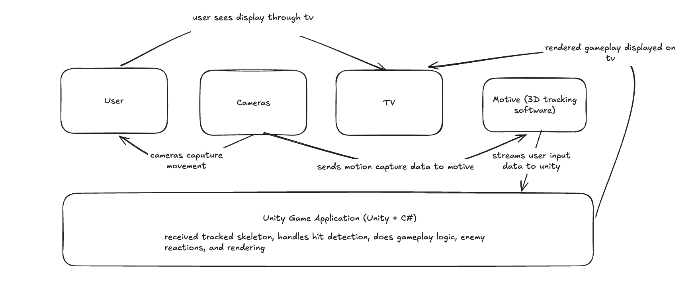

# Markerless Game —  Design Document

### Overview

The Markerless Game is motion-controlled boxing game designed to provide an interactive gameplay experience using full-body motion tracking. The player controls their character through physical movements captured by motion capture cameras. The game uses tracked body positions to detect player actions, determine collisions, and trigger corresponding enemy reactions and animations.

The system is designed to run on a PC connected to a TV display. Motion capture data is processed through Motive, which provides tracked skeleton data to the Unity game application. Unity handles gameplay logic, collision detection, enemy behavior, animation, and rendering.

The primary goal is to develop a playable end-to-end experience that demonstrates the integration of motion capture, real-time game logic, and 3D animation.

### System Context

The system interacts with the following external actors and systems:

- **Player:** Interacts with the game through physical body movements.
- **Motion Capture Cameras:** Capture the player's movements and provide camera data to Motive.
- **Motive:** Motion tracking software that processes camera input and provides tracked skeleton data.
- **TV Display:** Displays the rendered gameplay output from the PC.

The game application is responsible for interpreting motion tracking data and translating it into gameplay actions. The player receives visual feedback through the TV display.

### Key Diagrams

#### C4 Level 1 — System Context Diagram

#### C4 Level 2 — Container Diagram

### Interfaces and Contracts

The system relies on the following interfaces between its major components.

| Interface | Producer | Consumer | Responsibility |
|---|---|---|---|
| Camera Data Interface | Motion Capture Cameras | Motive | Provides camera input for motion tracking |
| Motion Tracking Interface | Motive | Unity Game Application | Provides tracked skeleton data |
| Gameplay Logic Interface | Unity Scripts | Unity Physics Engine | Provides collision and physics calculations |
| Collision Feedback Interface | Unity Physics Engine | Unity Scripts | Reports detected collisions |
| Animation Interface | Unity Scripts | Unity Animation System | Triggers player and enemy animations |
| Rendering Interface | Unity Game Application | TV Display | Outputs rendered gameplay |

Data contracts are a deferred descision as we are still in the phase of planning game mechanics and visual concepts.

### Data Model

The game uses runtime data representing the player, motion tracking information, enemies, collisions, and gameplay progression.

The runtime data model is expected to be implemented using Unity objects, scripts, and data structures though the exact data model is currently a deferred descision.

No persistent database is currently identified as a requirement. Persistence needs, such as score storage or session records, will be decided at a later date.

### Deployment 

Production Target: The deployment target for the game has not yet been finalized and will be discussed with the project partner in future meetings. OptiTrack owns the infrastructure and Motive software license, so deployment configuration and access will need to be coordinated with OptiTrack. The team currently has limited access to the TV and live camera setup, primarily during scheduled project partner sessions. By the end of Fall term, the team aims to ship a walking skeleton that can process recorded video input captured using OptiTrack-owned cameras through Motive to generate skeletal tracking data, simulating the data flow of a live camera stream. This will allow the team to demonstrate an end-to-end gameplay pipeline before live camera integration becomes available after Winter term. The final deployment environment and its requirements will be agreed upon with the project partner. Deployment evidence will consist of a recorded gameplay demonstration showing the existing functionality of our walking skeleton by end of the fall term.

### Decisions Deferred on Purpose

The following decisions are intentionally deferred until the team has sufficient implementation experience or requirements.

| Decision | Reason for Deferral |
|---|---|
| Exact Motive-to-Unity integration method | Requires confirmation of available APIs, SDKs, and data formats |
| Data Contracts and Data Model | Requires additional meeting between all group members to decide on a data model before development, which will happen early in our development process |
| Hitbox sizing and collision rules | Requires gameplay prototyping and calibration |
| Animation implementation details | Requires selection and integration of character assets |
| Persistent score storage | Not necessary for the initial walking skeleton |
| Packaging and installation process | Depends on the final deployment environment |implementation |

### Open Technical Questions

The following questions remain open and may affect implementation or deployment.

- How will tracking loss or invalid skeleton data be handled? - Owner: Michael, to be answered when recorded data becomes available
- How will player and enemy hitboxes be defined and calibrated? Owner: Dylan, to be answered Week 6-8 fall term
- How will collision events be distinguished between different types of punches? Owner: Brett, to be answered Week 6-8 fall term
